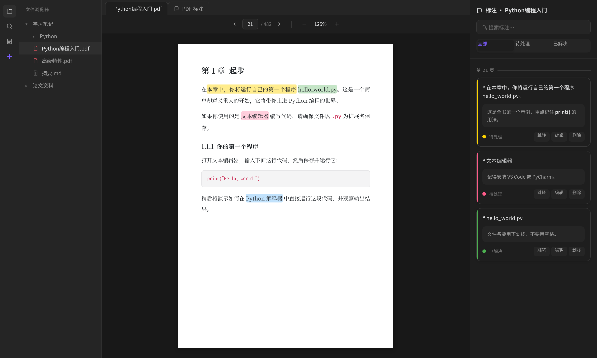
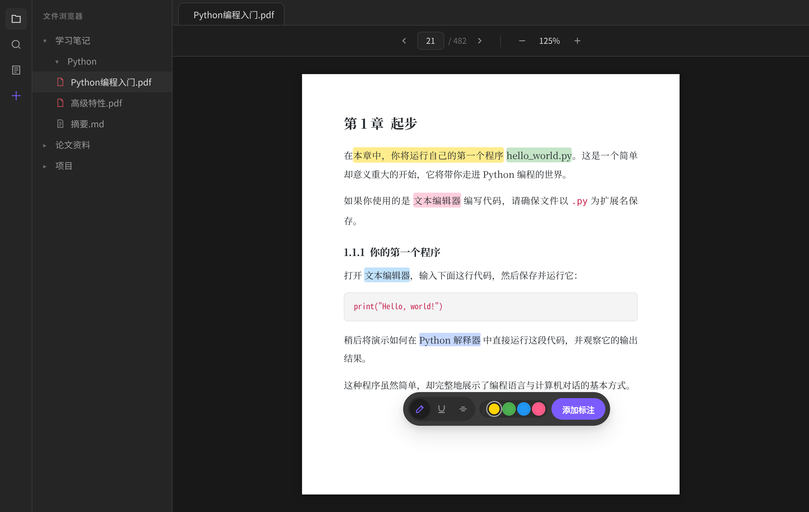
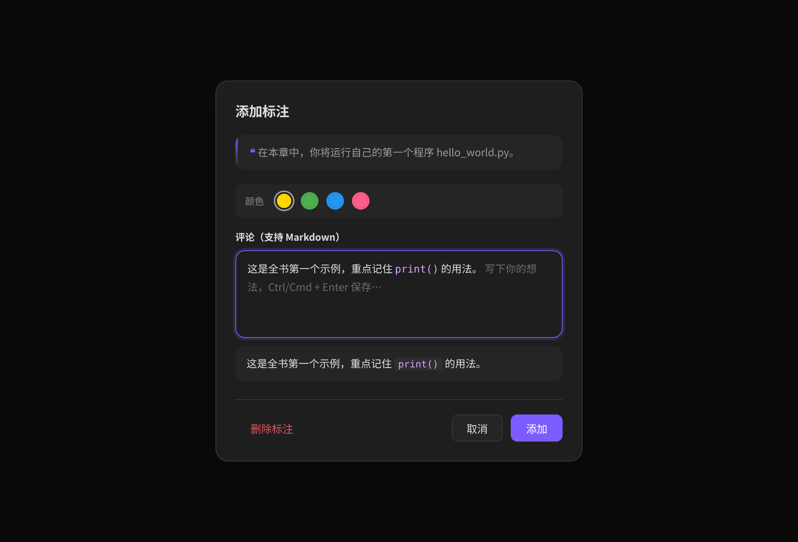
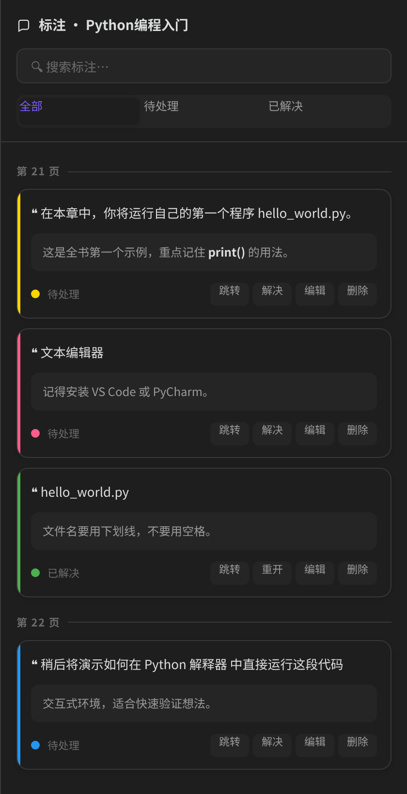

# PDF Annotate for Obsidian

[简体中文](./README.zh.md)

Add highlights, underlines, and strikethrough annotations directly to text in Obsidian's **PDF view**, and attach a Markdown comment to each annotation. Data is saved as sidecar JSON inside your vault — **your original PDF files are never modified**. Fully offline and privacy-friendly.


## Preview

**Full interface**: PDF view + annotations sidebar



**Text highlight & floating toolbar**: select text to add highlight / underline / strikethrough, and pick a color



**Comment modal**: Markdown with live preview



**Annotations sidebar**: grouped by page, with search, filtering, jump-to, edit, and delete



## Features

- **Text annotations**: select text in a PDF and use the floating toolbar to add a **highlight / underline / strikethrough** in one click, with four colors — yellow, green, blue, and pink.
- **Markdown comments**: every annotation can carry a Markdown comment with live preview; save with `Ctrl/Cmd + Enter`. Hover a highlight to quickly see the quote and its comment.
- **Annotations sidebar**: lists all annotations of the current PDF by page, with search, status filtering (open / resolved), click-to-jump, editing, and deletion.
- **Note integration**: export all annotations of the current PDF to a note of the same name, with each quote carrying a jump-to deep link.
- **Reading position memory**: remembers page number, zoom, and layout so you can pick up where you left off.
- **Low-spec friendly**: configurable performance tier (memory-saving / balanced / high-definition) and number of pre-rendered neighboring pages; also offers an optional custom single-page view.
- **Light & dark theme adaptive**: frosted-glass floating toolbar and card-style sidebar that follow your Obsidian theme.

## Installation

### Manual installation

1. Download the latest `main.js`, `manifest.json`, and `styles.css` from [Releases](../../releases).
2. Create the folder in your vault: `<vault>/.obsidian/plugins/pdf-annotate/`.
3. Copy the three files into it.
4. Restart Obsidian → **Settings → Community plugins** → enable **PDF Annotate**.


## Usage

### Adding an annotation

1. Open any PDF in Obsidian.
2. Select text with your mouse → the floating toolbar appears.
3. Choose a type (highlight / underline / strikethrough) and a color.
4. If you want a comment, type it in the input box that appears and press `Ctrl/Cmd + Enter` to save.

### Viewing and managing annotations

Three ways:

| Method | Action |
| ------ | ------ |
| **Annotations sidebar** (main entry) | Click the 💬 icon in the left ribbon, or run `PDF Annotate: Toggle Annotations Sidebar` from the command palette |
| **Click a highlight** | Opens that annotation's comment editor directly |
| **Hover a highlight** | Shows the quote and a summary of the comment |

The sidebar supports search, filtering by status, jumping to the corresponding page, editing, and deleting. Deletion can be done from a sidebar entry or within the comment editor.

> The sidebar shows annotations for the **currently open PDF**; it is empty when no PDF is open — this is normal.

### Paging and zoom

By default, Obsidian's **native PDF view** is used: scrolling to turn pages, zooming, and page-number jumps are all handled by Obsidian, and annotations stay aligned with the text. In continuous-scroll mode, to advance page by page you can use the Left/Right arrow keys (with focus inside the PDF and no selection) or the page box in the toolbar.

### Optional: single-page view

If your computer is low-spec, you can enable the custom single-page view — it renders only the current page at a time, with no sliding between pages and no zoom misalignment:

- Enable **"Auto-enter single-page mode when opening PDFs"** in the plugin settings; or
- Run `PDF Annotate: Open current PDF in "single-page mode" (load current page only)` from the command palette.

Single-page view controls:

| Action | How |
| ------ | --- |
| Turn page | Toolbar ‹ › , or `←` `→` / `PageUp` `PageDown` (click the reader area first to give it focus) |
| Zoom | Toolbar ＋ / － , or the "Fit width" button |
| Annotate | Exactly the same as the native view |

Both views **share the same annotation data** and can see each other's annotations.

## Settings

| Setting | Description |
| ------- | ----------- |
| Auto-enter single-page mode when opening PDFs | Off by default; enable on low-spec devices |
| Default highlight color | Yellow / Green / Blue / Pink |
| Highlight opacity | 10% – 80% |
| Open comment box after adding | Immediately open the comment input after creating a highlight |
| Default reading layout | Continuous scroll / Single-page paging |
| Performance tier | Memory-saving / Balanced / High-definition |
| Pre-rendered neighboring pages | How many pages to keep rendered before and after the current page (0 = current page only) |
| Show annotations sidebar when opening PDF | Auto-expand the sidebar |
| Resolved annotations | Dim / Hide |

## Commands

| Command | Description |
| ------- | ----------- |
| `PDF Annotate: Toggle Annotations Sidebar` | Toggle the annotations sidebar |
| `PDF Annotate: Toggle reading layout (continuous scroll / single-page paging)` | Switch layout |
| `PDF Annotate: Open current PDF in "single-page mode" (load current page only)` | Enter the custom single-page view |
| `PDF Annotate: Export current PDF's annotations to note` | Export to a Markdown note |

## Data storage

Each PDF has a corresponding sidecar JSON:

```
<vault>/.obsidian/plugins/pdf-annotate/annotations/<hash>.json
```

Annotation coordinates use **normalized values (0..1)** relative to the page width and height, so highlights automatically stay aligned when zooming or resizing — no recalculation needed. The original PDF file is never altered.


### Implementation notes

The drawing of the highlight overlay is driven by PDF.js's `textlayerrendered` event: the `source` it carries (the page's `PDFPageView`) and its `div` are exactly the node whose text has already been rendered. The plugin "clears the old layer first, then draws the current page's annotations" on that node. This gives the highlight the same lifecycle as the text layer, so it stays aligned automatically when paging, reusing nodes, or rebuilding nodes on zoom — fundamentally avoiding misalignment and cross-page bleed. The highlight layer fits `page.div` by percentage, so it follows zoom naturally without interfering with Obsidian's pagination state.

The plugin accesses non-public internal APIs of Obsidian's PDF viewer via monkey-around; these APIs may change between versions. If something misbehaves, please include your Obsidian version and logs prefixed with `[pdf-annotate]` from the console (Ctrl/⌘+Shift+I) in an Issue.

## Compatibility

- Obsidian 1.15.1 and above (tested on 1.15.1).
- Desktop.
- Scanned PDFs (no text layer) cannot be text-highlighted.

## License

MIT
