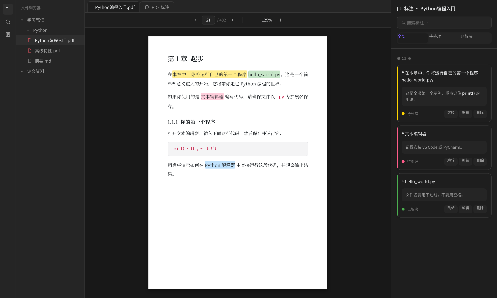
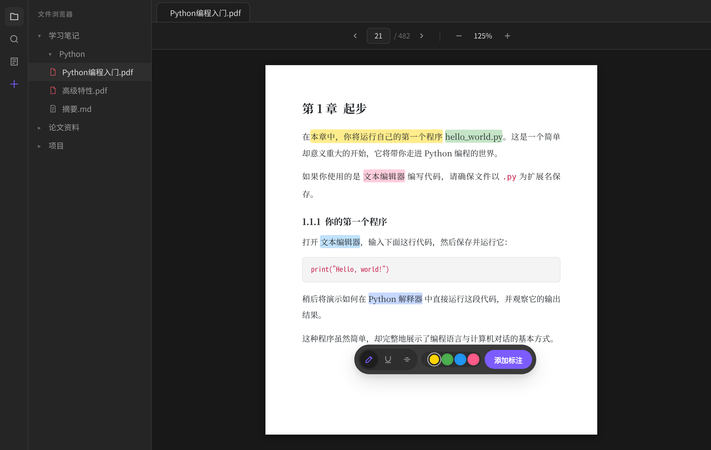
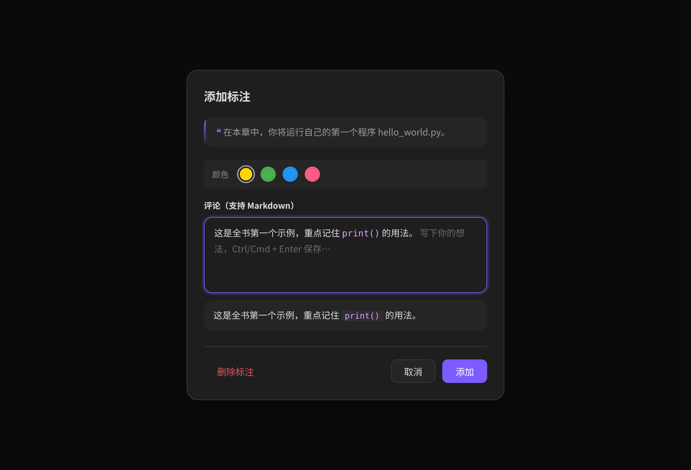
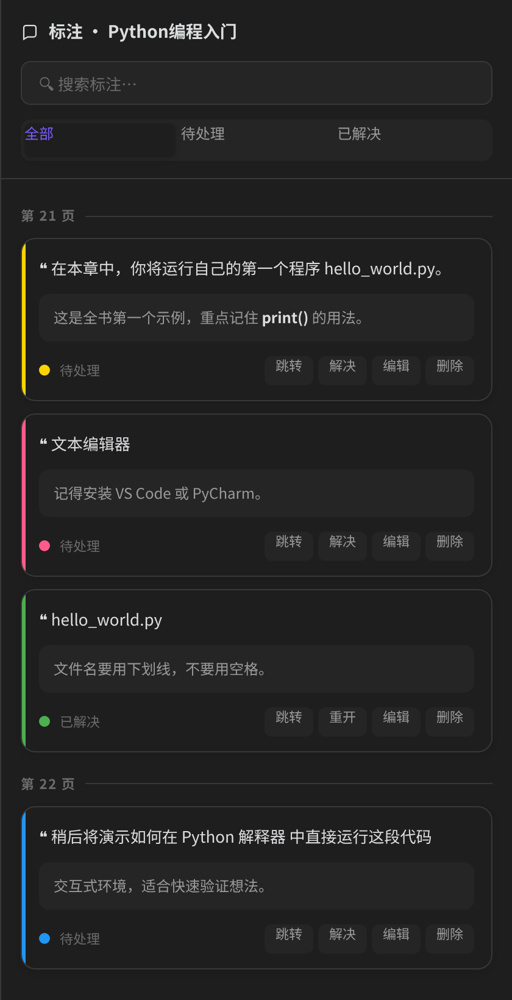

# PDF Annotate for Obsidian

[English](./README.md)

在 Obsidian 的 **PDF 视图**里直接对文字做高亮、下划线、删除线批注，并为每处标注添加 Markdown 评论。数据以 sidecar JSON 保存在你的 Vault 中，**不修改原始 PDF 文件**，完全离线、隐私安全。


## 预览

**完整界面**：PDF 视图 + 标注侧边栏



**文字高亮与浮动工具条**：选中文本即可添加高亮 / 下划线 / 删除线，并选颜色



**评论弹窗**：支持 Markdown 与实时预览



**标注侧边栏**：按页分组、搜索、筛选、跳转、编辑、删除



## 功能

- **文字批注**：选中 PDF 文本，浮动工具条一键添加**高亮 / 下划线 / 删除线**，支持黄、绿、蓝、粉 4 种颜色。
- **Markdown 评论**：每条标注都能附带 Markdown 评论，支持实时预览，`Ctrl/Cmd + Enter` 保存。悬停高亮块可快速查看引文与评论。
- **标注侧边栏**：按页列出当前 PDF 的全部标注，支持搜索、状态筛选（待处理 / 已解决）、点击跳转、编辑与删除。
- **笔记联动**：一键把当前 PDF 的所有标注导出为同名笔记，每条引文都带可跳转的深链接。
- **阅读位置记忆**：自动记住页码、缩放与布局，下次打开续读。
- **低配友好**：可配置性能档位（省内存 / 均衡 / 高清）与预渲染邻页数；另提供可选的自研单页视图。
- **明暗主题自适应**：毛玻璃浮动工具条、卡片式侧边栏，跟随 Obsidian 主题。

## 安装

### 手动安装

1. 从 [Releases](../../releases) 下载最新的 `main.js`、`manifest.json`、`styles.css`。
2. 在你的 Vault 中创建目录：`<vault>/.obsidian/plugins/pdf-annotate/`。
3. 将这三个文件复制进去。
4. 重启 Obsidian → **设置 → 社区插件** → 启用 **PDF Annotate**。


## 使用

### 添加批注

1. 在 Obsidian 中打开任意 PDF。
2. 用鼠标选中文字 → 浮动工具条出现。
3. 选择类型（高亮 / 下划线 / 删除线）和颜色。
4. 如需评论，在弹出的输入框中填写后按 `Ctrl/Cmd + Enter` 保存。

### 查看与管理标注

三种方式：

| 方式             | 操作                                                |
| -------------- | ------------------------------------------------- |
| **标注侧边栏**（主入口） | 点击左侧功能区的 💬 图标，或命令面板运行 `PDF Annotate: 打开/关闭标注侧边栏` |
| **点击高亮块**      | 直接打开该标注的评论编辑框                                     |
| **悬停高亮块**      | 显示引文与评论摘要                                         |

侧边栏支持搜索、按状态筛选、跳转到对应页面、编辑与删除。删除可在侧边栏条目或评论编辑框中完成。

> 侧边栏显示的是**当前打开 PDF** 的标注；未打开 PDF 时为空属正常现象。

### 翻页与缩放

默认使用 Obsidian **原生 PDF 视图**，上下滚动翻页、缩放、页码跳转均由 Obsidian 管理，标注会始终贴合文字。连续滚动模式下若需逐页翻页，可用左右方向键（焦点在 PDF 内、无选区时）或工具栏页码框。

### 可选：单页视图

如果电脑配置较低，可启用自研单页视图——一次只渲染当前一页，翻页不滑动、缩放不错位：

- 在插件设置中开启 **「打开 PDF 自动进入单页模式」**；或
- 命令面板运行 `PDF Annotate: 在当前 PDF 以「单页模式」打开（只加载当前页）`。

单页视图操作：

| 操作 | 方式                                                       |
| -- | -------------------------------------------------------- |
| 翻页 | 工具栏 ‹ › ，或 `←` `→` / `PageUp` `PageDown`（需先点一下阅读器区域获得焦点） |
| 缩放 | 工具栏 ＋ / － ，或「适应宽度」按钮                                     |
| 批注 | 与原生视图完全一致                                                |

两种视图**共用同一份标注数据**，可互相看到彼此的标注。

## 设置

| 设置项             | 说明                       |
| --------------- | ------------------------ |
| 打开 PDF 自动进入单页模式 | 默认关闭；低配设备可开启             |
| 默认高亮颜色          | 黄 / 绿 / 蓝 / 粉            |
| 高亮透明度           | 10% – 80%                |
| 添加后弹出评论框        | 创建高亮后立即打开评论输入框           |
| 默认阅读布局          | 连续滚动 / 单页翻页              |
| 性能档位            | 省内存 / 均衡 / 高清            |
| 预渲染邻页数          | 当前页前后各保留多少页已渲染（0 = 仅当前页） |
| 打开 PDF 时显示标注侧边栏 | 自动展开侧边栏                  |
| 已解决标注           | 淡显 / 隐藏                  |

## 命令

| 命令                                        | 说明              |
| ----------------------------------------- | --------------- |
| `PDF Annotate: 打开/关闭标注侧边栏`                | 切换标注侧边栏         |
| `PDF Annotate: 切换阅读布局（连续滚动 / 单页翻页）`       | 切换布局            |
| `PDF Annotate: 在当前 PDF 以「单页模式」打开（只加载当前页）` | 进入自研单页视图        |
| `PDF Annotate: 将当前 PDF 的标注导出到笔记`          | 导出为 Markdown 笔记 |

## 数据存储

每个 PDF 对应一个 sidecar JSON：

```
<vault>/.obsidian/plugins/pdf-annotate/annotations/<hash>.json
```

标注坐标采用相对页面宽高的**归一化值（0..1）**，因此缩放、窗口变化时高亮会自动贴合，无需重算。原始 PDF 文件不会被改动。


### 实现说明

高亮叠加层的绘制由 PDF.js 的 `textlayerrendered` 事件驱动：事件携带的 `source`（该页 `PDFPageView`）与其 `div` 正是当前已渲染好文字的节点，插件在该节点上「先清旧层、再画本页标注」。这样高亮与文字层同生命周期，翻页、节点复用、缩放重建节点时都能自动贴合，从根本上避免错位与串页。高亮层以百分比贴合 `page.div`，缩放时天然跟随，无需干预 Obsidian 的分页状态。

插件通过 monkey-around 访问 Obsidian PDF 查看器的非公开内部 API，这些 API 可能随版本变化；如遇异常，请在 Issues 中附上 Obsidian 版本与控制台（Ctrl/⌘+Shift+I）中 `[pdf-annotate]` 开头的日志。

## 兼容性

- Obsidian 1.15.1 及以上（已在 1.15.1 实测）。
- 桌面端。
- 扫描件 PDF（无文本层）无法进行文字高亮。

## License

MIT
